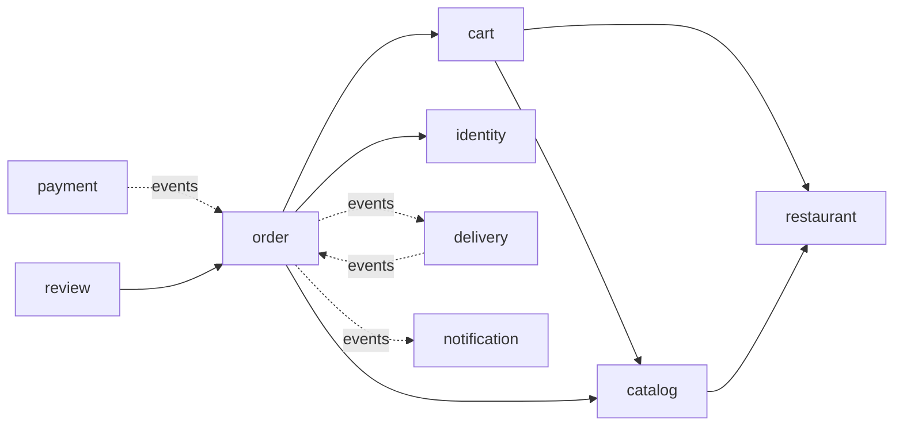
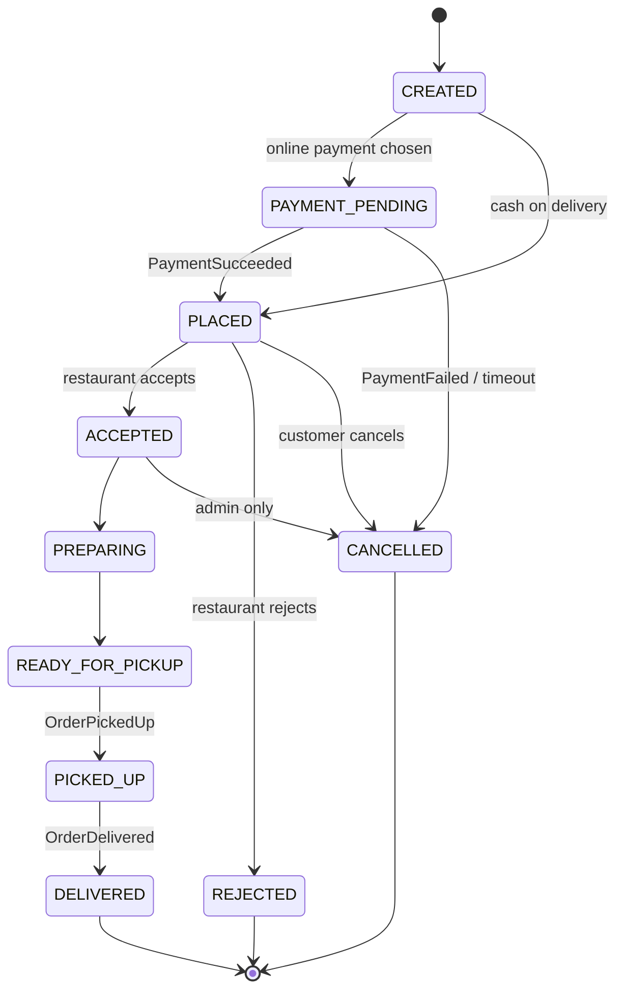
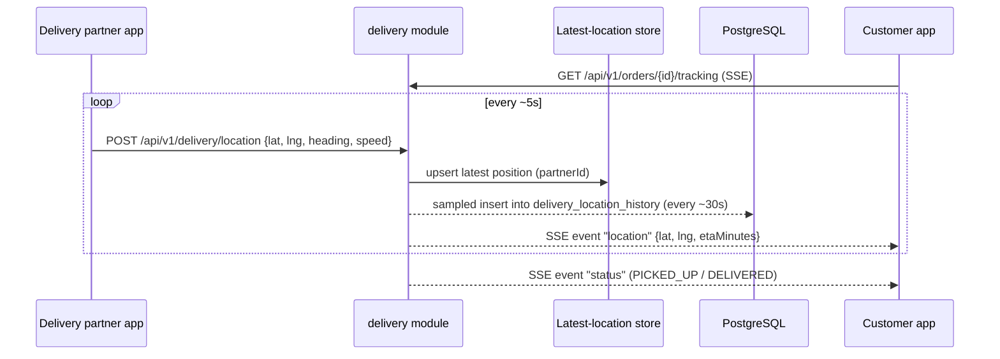
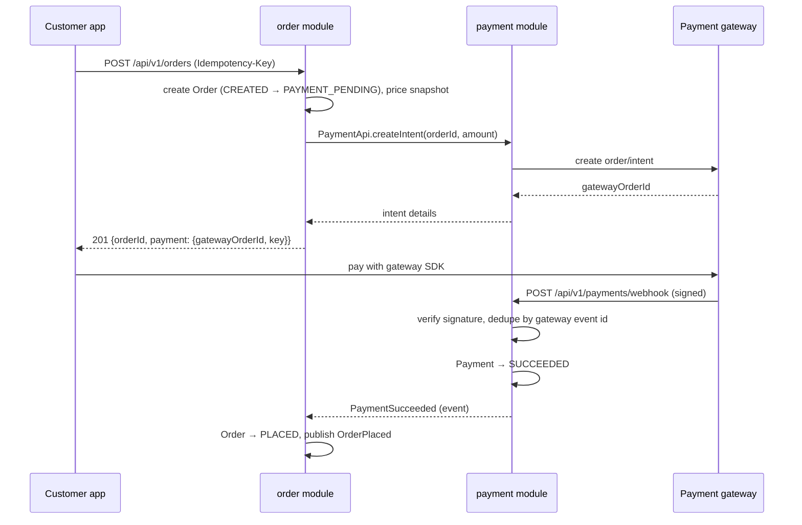

# Architecture — vsnvi-food

> Drafted from defaults — review and adjust.

## 1. Overview

vsnvi-food is a food-delivery backend (Zomato/Swiggy style) built as a **modular monolith**:
one Spring Boot deployable, one PostgreSQL database, internally split into business modules
with strict boundaries. See [ADR-001](adr/ADR-001-modular-monolith.md) for the rationale.

| Concern        | Choice                                                        |
|----------------|---------------------------------------------------------------|
| Runtime        | Java 25, Spring Boot 4.1                                      |
| Build          | Maven (wrapper)                                               |
| Persistence    | PostgreSQL, Spring Data JPA, Flyway migrations                |
| Security       | Spring Security, stateless JWT                                |
| Messaging      | In-process Spring events + transactional outbox               |
| Notifications  | Spring Mail (email); push/SMS later                           |
| Observability  | Spring Boot Actuator                                          |
| Testing        | JUnit 5, Testcontainers (PostgreSQL)                          |

Base package: `com.vsnvi.vsnvi_food`. Every module is a top-level sub-package
(`com.vsnvi.vsnvi_food.order`, …). Boundaries are enforced by convention today and can be
verified later with Spring Modulith (`ApplicationModules.verify()`).

## 2. Modules

| Module         | Responsibility                                                         | Key entities                                                   |
|----------------|------------------------------------------------------------------------|----------------------------------------------------------------|
| `identity`     | Registration, login, JWT issue/refresh, roles, profiles, addresses     | `User`, `Role`, `Address`, `RefreshToken`                      |
| `restaurant`   | Restaurant onboarding, outlets, opening hours, serviceable radius      | `Restaurant`, `Outlet`, `OpeningHours`                         |
| `catalog`      | Menus, categories, items, variants, add-ons, item availability         | `Menu`, `MenuCategory`, `MenuItem`, `Variant`, `AddOn`         |
| `cart`         | One active cart per customer, items from a single restaurant only      | `Cart`, `CartItem`                                             |
| `order`        | Checkout, pricing snapshot, order lifecycle state machine              | `Order`, `OrderItem`, `OrderStatusHistory`                     |
| `payment`      | Payment intents, gateway integration, webhooks, refunds                | `Payment`, `PaymentAttempt`, `Refund`, `ProcessedWebhook`      |
| `delivery`     | Partner availability, assignment, delivery tasks, live tracking        | `DeliveryPartner`, `DeliveryTask`, `LocationPing`              |
| `notification` | Email now; push/SMS later; reacts to events only                       | `NotificationLog`                                              |
| `review`       | Ratings and reviews for restaurants and delivery partners              | `Review`                                                       |
| `shared`       | Shared kernel: `Money`, ID types, base entity, auditing, error model, outbox | `OutboxEvent`                                            |

Roles: `CUSTOMER`, `RESTAURANT_OWNER`, `DELIVERY_PARTNER`, `ADMIN`.

### Module dependency direction

Solid arrow = synchronous call through the target's `api` facade.
Dashed arrow = asynchronous domain event.

## 3. Module communication rules

1. **Synchronous reads** go only through the target module's public `api` package
   (a facade interface plus DTO records). For example, `order` calls `CatalogApi.getItemsForPricing(...)`.
2. **Side effects across modules** go through **domain events**. A module never calls
   another module to say "now do X because I did Y"; it publishes an event.
3. A module **never** touches another module's entities, repositories or tables.
   No cross-module JPA relationships or SQL joins. Reference other modules' aggregates by ID only.
4. `shared` has no business logic and depends on nothing else.
5. Cycles between modules are not allowed.

## 4. Events

### Mechanism

- Publish with Spring's `ApplicationEventPublisher` from the application layer, inside the transaction.
- Consumers use `@TransactionalEventListener(phase = AFTER_COMMIT)`, so they only see committed state.
  If a consumer must write, it runs in its own transaction (`@Transactional(propagation = REQUIRES_NEW)`).
- **Transactional outbox:** every published domain event is also written to the `outbox_event`
  table in the same transaction. A scheduled relay marks events as processed and retries failed
  listeners. This makes delivery reliable and lets us swap to Kafka/RabbitMQ later without
  changing publishers.
- Events are immutable Java records, named in the past tense, and carry IDs plus the minimal data
  consumers need. They never carry entities.
- Consumers must be **idempotent**, because the outbox delivers at least once.

### Event catalog

| Event                 | Publisher    | Consumers                               | Payload (key fields)                                   |
|-----------------------|--------------|-----------------------------------------|--------------------------------------------------------|
| `UserRegistered`      | identity     | notification                            | userId, email, role                                    |
| `OrderPlaced`         | order        | notification, restaurant dashboard (SSE)| orderId, restaurantId, customerId, total               |
| `PaymentSucceeded`    | payment      | order                                   | paymentId, orderId, amount, gatewayRef                 |
| `PaymentFailed`       | payment      | order, notification                     | paymentId, orderId, reason                             |
| `OrderAccepted`       | order        | delivery, notification                  | orderId, restaurantId, prepTimeMinutes                 |
| `OrderRejected`       | order        | payment (refund), notification          | orderId, reason                                        |
| `OrderReadyForPickup` | order        | delivery                                | orderId, outletId                                      |
| `DeliveryAssigned`    | delivery     | order, notification                     | orderId, deliveryTaskId, partnerId                     |
| `OrderPickedUp`       | delivery     | order, notification                     | orderId, partnerId, pickedUpAt                         |
| `OrderDelivered`      | delivery     | order, notification, review             | orderId, partnerId, deliveredAt                        |
| `OrderCancelled`      | order        | payment (refund), delivery, notification| orderId, cancelledBy, reason                           |
| `RefundIssued`        | payment      | order, notification                     | refundId, orderId, amount                              |

## 5. Order lifecycle

| From               | Allowed to                               | Triggered by                         |
|--------------------|------------------------------------------|--------------------------------------|
| `CREATED`          | `PAYMENT_PENDING`, `PLACED`              | checkout                             |
| `PAYMENT_PENDING`  | `PLACED`, `CANCELLED`                    | payment events, 15-minute timeout job|
| `PLACED`           | `ACCEPTED`, `REJECTED`, `CANCELLED`      | restaurant owner, customer           |
| `ACCEPTED`         | `PREPARING`, `CANCELLED` (admin)         | restaurant owner, admin              |
| `PREPARING`        | `READY_FOR_PICKUP`                       | restaurant owner                     |
| `READY_FOR_PICKUP` | `PICKED_UP`                              | delivery partner                     |
| `PICKED_UP`        | `DELIVERED`                              | delivery partner                     |

Transitions are enforced inside the `Order` aggregate (`order.accept()`, `order.markPickedUp()`, …).
An illegal transition throws `InvalidOrderStateException` (HTTP 409). Every transition is appended
to `order_status_history`. `Order` uses optimistic locking (`@Version`).

The order stores a **pricing snapshot** (item names, unit prices, add-ons, taxes, delivery fee,
discount), so later menu changes never affect past orders.

## 6. Live tracking design

- **Ingestion:** partners `POST /api/v1/delivery/location` about every 5 seconds while on an active task.
  The request is validated (partner owns an active task, coordinates are within sane bounds,
  rate-limited).
- **Latest position:** held in an in-memory store behind a `LocationStore` interface. Swap to Redis
  when running more than one instance.
- **History:** sampled into `delivery_location_history` (about one row every 30 seconds per task)
  for disputes and analytics. Not every ping is persisted.
- **Fan-out:** customers subscribe with **Server-Sent Events** on `GET /api/v1/orders/{id}/tracking`.
  An `SseEmitter` registry keyed by orderId pushes `location` and `status` events. SSE is chosen over
  WebSocket because the traffic is one-way, it works over plain HTTP and it is simple with Spring MVC.
  WebSocket/STOMP stays an option for later.
- **ETA:** haversine distance ÷ an average speed for now, behind an `EtaCalculator` interface so a maps
  provider (Google, Mapbox, OSRM) can be plugged in.
- **Assignment:** on `OrderAccepted` (or `OrderReadyForPickup`), the delivery module picks the nearest
  available partner within a radius, offers the task, and falls back to the next partner after a timeout.
  It publishes `DeliveryAssigned`.
- **Scaling note:** with multiple instances, SSE subscribers may sit on a different node from the one
  that receives the ping. When we scale out, we add Redis pub/sub between nodes.

## 7. Payment flow

- **Gateway abstraction:** `PaymentGateway` interface (`createIntent`, `verifyWebhook`, `refund`) with a
  Razorpay implementation first and Stripe as an option. A `FakePaymentGateway` is used for local/test.
- **Webhook is the source of truth.** The client-side "success" callback is only a UX hint. The order
  becomes `PLACED` only after a verified webhook.
- **Idempotency:**
  - `Idempotency-Key` header on `POST /orders` and `POST /payments/*` (stored with the request hash and response).
  - Webhooks are deduplicated by the gateway event ID in `processed_webhook`.
- **Timeout:** a scheduled job cancels orders stuck in `PAYMENT_PENDING` for more than 15 minutes and
  publishes `OrderCancelled`.
- **Refunds:** on `OrderRejected` or `OrderCancelled` after a successful payment, the payment module
  issues a refund through the gateway and publishes `RefundIssued`. Refund webhooks update the refund status.
- **Cash on delivery:** skips the gateway. The order goes `CREATED → PLACED`, and the payment is recorded
  as `COLLECTED` on `OrderDelivered`.
- **Money:** stored as `NUMERIC(12,2)` with an ISO currency code, never floating point.
  Amounts sent to the gateway are in minor units (paise).

## 8. Cross-cutting concerns

- **Security:**
  - Stateless JWT (short-lived access token plus refresh token).
  - Method-level `@PreAuthorize` by role and ownership (an owner can only manage their own restaurants;
    a customer can only see their own orders).
  - The webhook endpoint is public but signature-verified.
- **Database:**
  - One schema; tables prefixed or grouped by module ownership.
  - Flyway migrations in `src/main/resources/db/migration`, named `V{n}__{module}_{description}.sql`.
- **Errors:** a single `@RestControllerAdvice` maps exceptions to RFC 9457 Problem Details
  (see [API_GUIDELINES.md](API_GUIDELINES.md)).
- **Observability:**
  - Actuator health/metrics/info.
  - A trace ID (`traceId`) in MDC, returned in error responses.
  - Structured logs.
- **Time:** all timestamps stored and returned in UTC (`Instant` / `timestamptz`).
- **Testing:**
  - Domain unit tests.
  - `@WebMvcTest` slices.
  - Module integration tests against Testcontainers PostgreSQL (`TestcontainersConfiguration` already exists).

## 9. Future evolution

Extract a module into a service only when one of the criteria in ADR-001 is met. Likely candidates,
in order:

1. **delivery/tracking:** high write volume from location pings, and needs independent scaling.
2. **notification:** already purely event-driven, so it is easy to lift out.
3. **payment:** for PCI scope isolation, if needed.

Before any extraction:

- Move the outbox relay to a real broker (Kafka/RabbitMQ).
- Move the location store and SSE fan-out to Redis.
